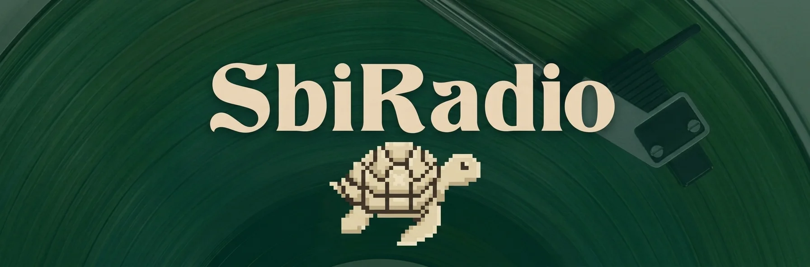

# SbiRadio — Tu Emisora

SbiRadio es una emisora comunitaria y un reproductor web minimalista. Nació como un
espacio para escuchar música tranquila sin ruido, sin cuentas, sin anuncios y sin
distracciones: abres la página, pulsas reproducir y ya estás escuchando.

Todo el sitio es estático — HTML, CSS y JavaScript sin dependencias.

## Qué encontrás

- **Reproductor directo al stream** — un `<audio>` nativo apuntando a la radio, sin
  librerías de terceros.
- **Contador de oyentes** — lee las conexiones activas del mount desde las
  estadísticas públicas de Icecast; si el servidor no responde, se oculta en vez de
  mostrar un número inventado.
- **Sobre la radio** — una sección breve con la identidad de la emisora y su
  compromiso: sin cuentas, sin anuncios y Software Libre.
- **Dónde escuchar** — enlaces al stream directo y un archivo `sbiradio.pls`
  para abrirlo en VLC, foobar2000 u otra app de radio, más un botón para
  compartir en móviles.
- **Estética retro** — portada de vinilo, tipografías pixeladas y degradados suaves,
  pensados para acompañar la música en vez de competir con ella.
- **Cero dependencias** — no hay librerías ni frameworks: solo HTML, CSS y
  JavaScript nativos.

## Estructura del código

El JS se carga como módulos ES (`<script type="module">`), sin build ni
dependencias. Por eso el sitio necesita servirse por HTTP (por ejemplo
`python3 -m http.server` o la extensión Live Server); abrir `index.html`
directamente con `file://` no carga los módulos.

- `js/main.js` — punto de entrada y orden de arranque.
- `js/player/elements.js` — referencias al DOM de la página.
- `js/player/status.js` — placa de estado y marquesina del stream.
- `js/player/resilience.js` — reintentos automáticos y recuperación del stream.
- `js/player/volume.js` — volumen y mute persistentes.
- `js/player/controls.js` — controles propios del reproductor.
- `js/player/media-session.js` — identidad en la pantalla bloqueada.
- `js/listeners.js` — contador de oyentes de Icecast.
- `js/share.js` — botón de compartir.

## Créditos

Hecho con ❤️ y Software Libre por **~SbiDev**.

Streaming provisto por [Yanapak](https://radios.yanapak.org).

Las tipografías incluidas en `assets/fonts/` son obra de sus respectivos autores y
conservan sus propias licencias; no están cubiertas por la GPLv3 de este proyecto.

## Licencia

El código de este proyecto se distribuye bajo los términos de la
[GNU General Public License v3.0](LICENSE).

Copyright (C) 2026 SbiDev.
